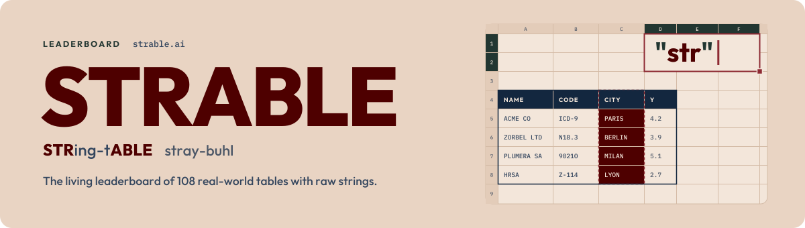

<picture>
  <source media="(prefers-color-scheme: dark)" srcset="docs/banner-dark.svg">
  
</picture>

[](https://gblayer.github.io/strable-leaderboard/)
[](https://arxiv.org/abs/2605.12292)
[](https://huggingface.co/datasets/inria-soda/STRABLE-benchmark)
[](#) <!-- TODO: link to the NeurIPS 2026 video presentation -->

The living leaderboard of [STRABLE](https://arxiv.org/abs/2605.12292), the benchmark of 108 real-world tables with raw strings: 76 regression and 32 classification tasks. One score and one run time per pipeline, Pareto-optimal pipelines first.

If you benchmark on STRABLE, [star this repository](https://github.com/gblayer/strable-leaderboard/stargazers) and cite the paper ([BibTeX](#citation)). To claim a rank, name the board version and date shown at the top of the page.

**Leaderboard:** https://gblayer.github.io/strable-leaderboard/

The board currently holds the paper's 75 Figure 4a pipelines, version v0.1.0-pre.

## Submit a model

<!-- The page's "Submit a model" button links to this heading (#submit-a-model): keep its text. -->

You submit code, not results.

1. **Fork** the repository on GitHub: your own copy, since you cannot push to this one.
2. **Add one folder**, `models/<name>/`, with `model.py`, `model.yaml` and `requirements.txt`, starting from [models/_template/](models/_template/). No container, no bash script. Packages must be the pinned versions listed in `env/requirements.txt`, the shared environment. Your coding agent can do it; tell it:
   ```
   Add my model to the STRABLE leaderboard, test it, and open a pull request.
   ```
   It follows [AGENTS.md](AGENTS.md) and [.claude/skills/add-model/SKILL.md](.claude/skills/add-model/SKILL.md).
3. **Run the smoke test:** `python -m strable_leaderboard.smoke models/<name>`.
4. **Open a pull request** from your fork.

**What happens next.** Automatic checks run and Claude reviews the pull request twice. If everything passes, it is merged automatically; otherwise the maintainer reviews it. After the merge we run the model on all 108 tables × 3 folds and the board updates. Details: [docs/submitting.md](docs/submitting.md).

## Check your model locally

```
pip install -e ".[smoke]" -r models/<name>/requirements.txt
python -m strable_leaderboard.smoke models/<name>
```

The first line installs this package, the smoke-test tools and your model's packages. The second runs your model on outer fold 0 of three small tables and checks its card and predictions; it does not compute leaderboard scores.

## Layout

| Path | |
|---|---|
| [models/](models/) | One folder per model: `_template/` to start from, `ridge/` as a working example |
| [strable_leaderboard/](strable_leaderboard/) | Splits, metrics, the model contract and the smoke test |
| [splits/](splits/) | Outer and inner cross-validation folds of all 108 tables |
| [docs/protocol.md](docs/protocol.md) | Data, cross-validation, score, time, encoders, hardware |
| [docs/submitting.md](docs/submitting.md) | The contract, the model card, versions, examples |
| [AGENTS.md](AGENTS.md) | Where coding agents start |

Maintainer and infrastructure files: `scripts/`, `site/`, `tests/`, `docs/`.

## Contact

Gioia Blayer, gioia.blayer@inria.fr

## Citation

```bibtex
@misc{blayer2026strablebenchmarkingtabularmachine,
      title={STRABLE: Benchmarking Tabular Machine Learning with Strings},
      author={Gioia Blayer and Myung Jun Kim and Félix Lefebvre and Lennart Purucker and Alan Arazi and Eilam Shapira and Roi Reichart and Frank Hutter and Marine Le Morvan and David Holzmüller and Gaël Varoquaux},
      year={2026},
      eprint={2605.12292},
      archivePrefix={arXiv},
      primaryClass={cs.LG},
      url={https://arxiv.org/abs/2605.12292},
}
```

## Issues and ideas

[Open an issue](../../issues/new/choose) for a bug, a wrong score, a table problem or a feature.
