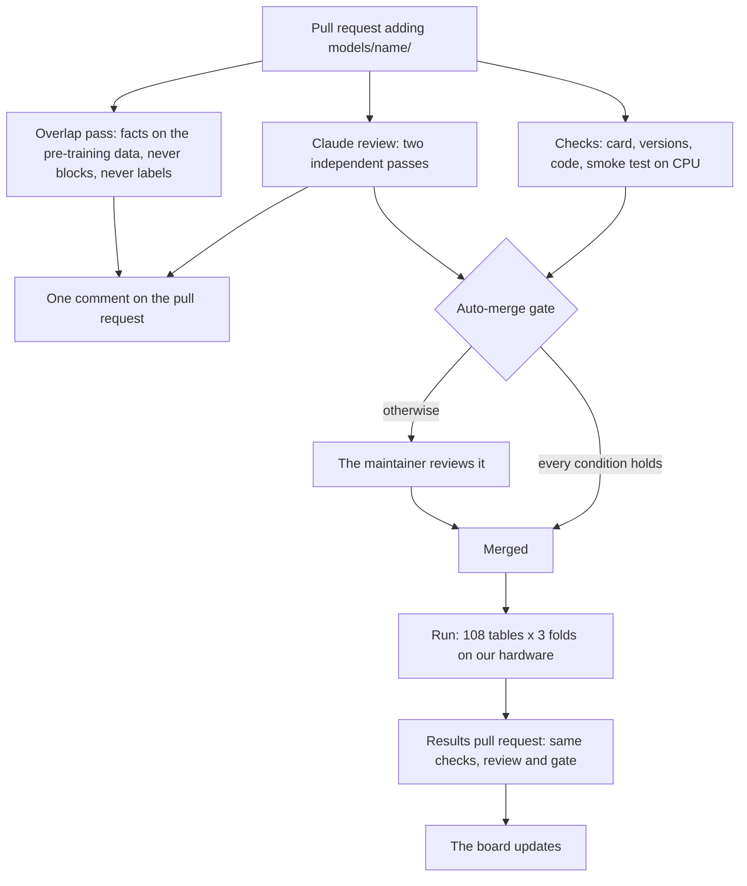

# What happens after a pull request is opened

## 1. Checks

`.github/workflows/checks.yml` runs on every pull request, on GitHub's machines, without secrets. It runs the tests, then, for each changed model folder, the checks of the card, the versions and the code, and the smoke test on CPU. A GPU model (`hardware: gpu`) gets the static checks only; its smoke test runs on our GPU after the merge. So does an API model (`hardware: api`, below). For a results pull request, `scripts/build_site_data.py --check` validates the results files, including that their overlap fields match `site/flags.json`.

## 2. Claude review

`.github/workflows/claude-review.yml` runs two review passes: two fresh Claude sessions that never see each other's answer, with the checklist of `.claude/skills/review-submission/SKILL.md`. Each answers MERGE, FIX or REJECT, with one line per problem. They read the pull request through GitHub only: they never run its code, and they cannot comment, label or merge.

A third pass, the overlap job (`.claude/skills/review-overlap/SKILL.md`), runs on a pull request that adds a model. It reads the model's paper, Hugging Face card and code README, and reports facts only: the model's documented pre-training data, and public reports of overlap with STRABLE tables, each with a quote and its link. It never blocks the merge and never adds a label.

One comment on the pull request gives both verdicts and these facts.

## 3. Auto-merge gate

`scripts/automerge_gate.py` decides, in code: Claude does not. A pull request merges by itself only if:

1. both review passes of the current commit said MERGE (the commit status "Claude review" is success);
2. the Checks workflow passed on the current commit;
3. the diff is exactly one new `models/<name>/` folder, whose name is valid, is not one that only the maintainer adds (`RESERVED` in `strable_leaderboard/__init__.py`) and, unless the pull request is opened by `gblayer`, does not start with `test-`; or only the results files (`RESULTS_FILES` in `strable_leaderboard/__init__.py`) in a pull request opened by `gblayer`. Nothing else: `.github/`, `.claude/`, `strable_leaderboard/`, `scripts/`, `splits/`, `env/` and existing model folders never merge by themselves;
4. the label `needs-maintainer` is not set;
5. the commit did not change since the reviews (`gh pr merge --match-head-commit`).

Otherwise the gate adds `needs-maintainer` and comments "@gblayer your review is needed: <reason>". A pull request that adds a package to `env/requirements.in` always waits for the maintainer, and the comment lists what the environment would add or change. The maintainer's own pull requests get no review and merge by hand, except results updates and model folders.

## 4. The run

After the merge, `scripts/dispatch.py` runs the model on our hardware: first the smoke test, then every table and outer fold. A numeric-only model runs with each of the four string encoders (4 × 108 × 3 = 1,296 tasks), an end-to-end one alone (324 tasks). Each task runs the model in a sandbox that sees only the training rows, the test rows without their labels, and the model's weights. The board times and scores the predictions outside the sandbox.

When the run starts, a comment on the model's pull request gives the number of tasks and a rough estimate of when the results will be ready. If something fails, the maintainer is told on the pull request.

**API models.** A model whose card says `hardware: api` runs on its provider's servers, behind an API. Only the maintainer adds one, and merges it by hand. Per task, the model sends the provider what every model gets: the training rows with their labels, and the test rows without theirs. The test labels never leave our side, which scores the predictions as for every model. The endpoint and the key live only in `private/api_keys/<model folder>.env` on the cluster (git-ignored, mode 600: the runner refuses a file others can read), never in the card or the repository; the card's `api` block holds only `auth` (`Bearer` or `Api-Key`) and `concurrency`. The runner passes the endpoint and key to that model's sandbox only, which keeps the network; every other sandbox has it cut. The dispatcher never starts an API model by itself: it waits until the maintainer adds the label `run-api` to the model's pull request, then runs the smoke test and the tasks like any model, as CPU jobs, at most `concurrency` tasks at once. A row's time is the wall-clock time at our side, so it includes the network and the provider's hardware. The row records `hardware` "api" and the version the provider reported (`api_version`); a version that changes during the run stops the results at `check_results`. On the page, the model's pipelines show a small grey API box next to their name, a round marker on the plot and the hover text "Runs on the provider's servers: the time includes the network and their hardware."; the switch "API: Show | Hide", shown only when the board has an API model, hides them from the table, the plot, the Pareto front, the counts and the downloads of the ranking (`#no-api` in the address). `results.json` marks their pipelines `"api": true`, with `api_version`.

## 5. Results and the board

The results come back as a pull request opened by `gblayer` that changes only the results files of `site/`. It goes through the checks, the review and the gate. Once it is merged, the page updates and the board's version goes up by one (for example v0.1.2 to v0.1.3); the merge commit is tagged with it.

**Possible overlap.** The review only reports facts. The maintainers decide whether a model's pre-training data may overlap with STRABLE tables. If so, they add the label `pretraining-overlap` to the model's pull request, and the dispatcher writes `{"<model folder>": {"overlap": true, "evidence": "<url>"}}` into `site/flags.json` when it publishes the results; they can also edit that file by hand. On the page, the model's pipelines then show a small ∩ next to their name, with a link to the evidence, and the switch "Overlap ∩: Show | Hide" hides them (`#no-overlap` in the address). The results files carry the mark too: `overlap` and `overlap_evidence` in `results.json`, a true/false `overlap` column in the Parquet and CSV files.

## 6. Maintainers

- Reviewing a pull request by hand: `.claude/skills/review-submission/SKILL.md`.
- Running a model and publishing its results: the dispatcher (`scripts/dispatch.py`) does it. By hand, and to set the automation up: `.claude/skills/run-model/SKILL.md`.
- The page is `site/index.html`, deployed by `.github/workflows/pages.yml`. It reads `site/results.json`, which `scripts/build_site_data.py` writes.
- Scores, folds, encoders and times follow the [paper](https://arxiv.org/abs/2605.12292); only the maintainer changes them.
- Results reach this repository only as the results files of `site/` (`RESULTS_FILES`). Never commit `results/`, `runs/`, data, weights, `cache/` or `private/`, and never name the machines the runs use.
