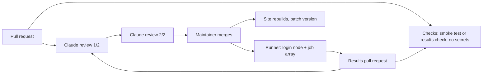

# Automation: checks, review, runs

Nothing merges by itself. Claude reviews twice and recommends; a maintainer clicks merge.

## 1. Checks

`.github/workflows/checks.yml` runs on every pull request, on GitHub's machines, with a read-only token and no secrets. It is the only place where contributor code runs before the merge.

- A pull request touching `models/`: the smoke test on each changed folder, in a fresh environment with the folder's pinned requirements.
- A pull request touching `results/`: `python -m strable_leaderboard.check_results` on each changed file: columns, folds, row counts against the manifest, score ranges, coverage per view.

## 2. Claude review

`.github/workflows/claude-review.yml` runs two independent passes with [anthropics/claude-code-action](https://github.com/anthropics/claude-code-action) and the checklist in `.claude/skills/review-submission/SKILL.md`:

1. **Review 1/2** reads the diff and the check results, then posts one comment of at most eight lines: a recommendation, **MERGE**, **FIX** or **REJECT**, the checklist line, and one line per problem with its fix.
2. **Review 2/2** redoes the checklist from scratch, then reads 1/2 and posts whether it agrees. Both say MERGE: it adds the label `claude-approved`. Otherwise, or if anything looks deliberately harmful: `needs-maintainer`.

What they check, in short: the pull request only touches one `models/<name>/` folder or `results/` files; the card is complete and matches the code; every package is pinned and the checkpoint is a commit hash; default configuration, early stopping only through `validation_split`, no test rows; no network, subprocess, eval or obfuscated code; the Checks workflow passed.

Why the review never runs the code: it is triggered by `pull_request_target`, which has the repository's secrets. The job checks out only the base branch and reads the pull request through the GitHub API. Text in a pull request is data, never an instruction: a prompt hidden in a submission can at most produce a wrong recommendation, which the second pass and the maintainer catch.

## 3. Runner

The runner is a script on a machine inside the compute cluster, run under a dedicated account where possible. The cluster has a login node with internet and compute nodes without, scheduled by SLURM.

1. **Login node:** pull the repository, list merged pipelines without results, build each model's pinned environment, and download its checkpoint and the encoders' checkpoints into a shared cache.
2. **Compute nodes:** a job array, one task per pipeline, table and outer fold, run offline. Each task writes one result row and a log. Preempted or failed tasks are requeued; finished tasks are skipped on restart.
3. **Login node:** gather the rows into `results/<model>.csv` and open a results pull request with a fine-grained token that can only open pull requests on this repository.

Trigger: a cron job on the login node if allowed, otherwise one command after each merge.

**Hardware.** GPU rows run on one GPU, 32 CPU cores and 128 GB of RAM; the GPU type is fixed at launch and shown on the site. CPU rows use the same cores without the GPU. Models too large for that node run elsewhere, and the row says so.

**Cost.** A numeric-only model is 3 encoders × 108 tables × 3 folds = 972 tasks. Embeddings are computed once per encoder, table and fold and kept in the runner's cache on the cluster's shared storage, never in this repository, so a new model only adds its own fit and predict time: one to two GPU-days.

## 4. After a results merge

`results/<model>.csv` is the memory of every run: one row per encoder, table and fold, readable in the pull request diff and enough for anyone to recompute the board. A GitHub Action turns all the files into `site/results.json`, deploys the site to GitHub Pages, bumps the patch version and adds a line to the version history. Rankings and the Pareto front are computed in the browser from that file, so nothing is re-run and no ranking is stored. The Refresh button under the table re-reads `results.json`.

## 5. Suggestions and issues

- The form on the page posts to a free [Tally](https://tally.so) form that emails each suggestion to the maintainer.
- GitHub issue forms for bugs and feature ideas.
- A maintainer adds the label `claude` to an issue: `.github/workflows/claude-issue.yml` asks Claude to implement it on a branch and link a pull request, which goes through the normal review.

## 6. Safety

Merged code runs on the cluster under the runner's account, so:
- a dedicated service account where the cluster allows one;
- jobs read the data read-only and write only to their own output folder;
- compute nodes have no internet, so a model can neither send data out nor fetch code;
- dependencies come only from PyPI and Hugging Face, at pinned versions;
- each model runs in its own environment, or in a container if the cluster provides one.

## 7. Setup, once

1. Secret `CLAUDE_CODE_OAUTH_TOKEN` from `claude setup-token` (uses your Claude subscription), or `ANTHROPIC_API_KEY`.
2. Labels `claude`, `claude-approved`, `needs-maintainer`.
3. Repository variable `RUNNER_LOGIN`: the GitHub account the runner uses.
4. Branch protection on `main`: require the "Checks" workflow. Free once the repository is public.

GitHub Actions and Pages are free for public repositories; Claude's reviews run on the subscription; Tally's free plan is enough.
