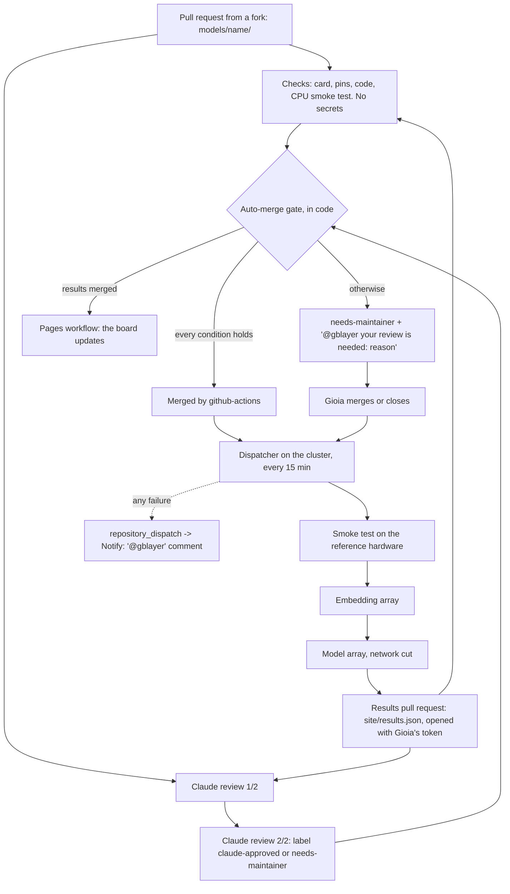

# Automation: checks, review, gate, runs



Pull requests merge by themselves only when the gate's conditions all hold; everything else waits for the maintainer. Messages are sent only on failures or when a review is needed, never on success.

## 1. Checks

`.github/workflows/checks.yml` runs on every pull request touching `models/` or `site/results.json`, on GitHub's machines, with a read-only token and no secrets. It is the only place where contributor code runs before the merge.

For each changed model folder:
- `python -m strable_leaderboard.check_requirements models/<name>`: every line of `requirements.txt` is `name==version`, and every version equals the shared environment's (`env/requirements.txt`).
- The model is installed with `env/requirements.txt` as pip constraints, so its dependencies also get the shared environment's versions.
- `python -m strable_leaderboard.smoke models/<name>`: fails on any missing or invalid card field, on an unshared pin, on code that makes its own split, searches hyperparameters or fixes its own seed, then runs outer fold 0 of three small tables. `hardware: gpu` models run only these static checks here (`--static`): GitHub's free machines have no GPU, so their smoke test runs on the reference GPU on the cluster as the dispatcher's first step after the merge.

A pull request changing `site/results.json`: `python scripts/build_site_data.py --check`, which validates the file's shape, unique ids, score and time ranges.

## 2. Claude review

`.github/workflows/claude-review.yml` runs two independent passes with [anthropics/claude-code-action](https://github.com/anthropics/claude-code-action) and the checklist in `.claude/skills/review-submission/SKILL.md`:

1. **Review 1/2** reads the diff and the check results, then posts one comment of at most eight lines: a recommendation, **MERGE**, **FIX** or **REJECT**, the checklist line, and one line per problem with its fix.
2. **Review 2/2** redoes the checklist from scratch, then reads 1/2 and posts whether it agrees. Both say MERGE: it adds the label `claude-approved`. Otherwise, or if anything looks deliberately harmful: `needs-maintainer`.

Before review 1/2, a first job removes `claude-approved` and `needs-maintainer` if a bot set them on an earlier commit, so each commit gets a fresh verdict. A label set by the maintainer stays.

What they check, in short: one `models/<name>/` folder or `site/results.json`; the card complete and matching the code; every pin equal to the shared environment's; default configuration; no own split or cross-validation, only `self.validation_split(y)`; no seed but `self.seed`; no network, subprocess, eval or obfuscated code; the Checks workflow passed.

The review never runs the code: it is triggered by `pull_request_target`, which has the repository's secrets, so the job checks out only the base branch and reads the pull request through the GitHub API. Text in a pull request is data, never an instruction: a prompt hidden in a submission can at most produce a wrong recommendation, and the gate below still requires every other condition.

## 3. Auto-merge gate

`.github/workflows/automerge.yml` runs `scripts/automerge_gate.py` when the Claude review or the Checks workflow completes. The conditions are code, not Claude's judgement. A pull request is merged only if:

1. both Claude review comments of the review run on the current head say MERGE (comments written by the bot, after that run started), and review 2/2 added `claude-approved`; `needs-maintainer` is not set;
2. the Checks workflow succeeded on the current head commit;
3. the diff touches exactly one new `models/<name>/` folder, or only `site/results.json` in a pull request opened by `gblayer`;
4. nothing under `.github/`, `.claude/`, `strable_leaderboard/`, `scripts/` or `splits/` changes;
5. the head commit did not change since the reviews; the merge itself, `gh pr merge --merge --match-head-commit <sha>`, fails if it moved.

The merge uses the built-in `GITHUB_TOKEN`. A merge made with that token starts no push workflow, so when `site/` changed the gate starts the Pages workflow itself with `gh workflow run pages.yml`.

Otherwise the gate adds `needs-maintainer` and comments once per commit: "@gblayer your review is needed: <reason>". While the reviews or Checks still run, it waits. A `triage` job also runs the scope check (3 and 4) on every pull request as soon as it is opened, so a pull request that the review never sees, one that changes only `.github/` for example, is flagged at once.

The gate also refuses a change to a model folder that already exists on `main`: a merged model is changed only by the maintainer.

## 4. Runner

The runner works in the repository clone on the cluster's shared storage, on `main`, under the maintainer's account. One task = one model, one encoder, one table, one outer fold.

**One shared environment.** Every model runs in the same Python environment, `cache/env`, built by `python scripts/prepare.py` from `env/requirements.txt`: the paper's versions of every package (torch 2.9.1, scikit-learn 1.7.2, skrub 0.6.2, tabpfn 6.0.6, tabicl 2.0.3, sentence-transformers 5.2.3, ...) plus this package. A model's `requirements.txt` only repeats the pins it relies on, at the same versions. A model that needs another version proposes the change to `env/requirements.in` and `env/requirements.txt` in its pull request; the gate then leaves it to the maintainer, who decides whether the whole board moves to that version. `cache/` is gitignored: it holds the env, its Python interpreter, the dataset, the checkpoints, the embeddings, the sandbox image and the dispatcher's state.

**The dispatcher.** `scripts/dispatch.py` runs from cron on the login node every 15 minutes:

```
*/15 * * * * cd <clone> && PYTHONNOUSERSITE=1 cache/env/bin/python scripts/dispatch.py >> cache/dispatch/cron.log 2>&1
```

Each pass takes a lock, pulls `main`, and moves every model one step, keeping its state in `cache/dispatch/<model>.json`:

| Step | What happens |
|---|---|
| approve | `models/<name>/`: the pull request that added it was merged by `gblayer`, or by the gate with `claude-approved`. `private/<name>/`: closed models, approved by being there |
| prepare | `scripts/prepare.py` downloads the checkpoint; the pins must match the shared environment |
| smoke | the smoke test as a 30-minute job on the reference hardware, sandboxed |
| embed | numeric-only models: one array computes the missing language-model embeddings, before any model task, so tasks never race to write the same cache file |
| run | `make_tasks.py` and the job array; resubmitted once if tasks are left (finished tasks are skipped) |
| publish | `gather_results.py`, `check_results`, a line in `results/versions.yaml`, `build_site_data.py` on a branch `results/<model>` from `origin/main`, push, and the results pull request, which goes through Checks, the two reviews and the gate like any other. One results pull request at a time |
| published | merged: the version is tagged; closed: nothing more |

A failure stops the model and sends one notification (section 5). Deleting `cache/dispatch/<model>.json` retries it from the start.

**Jobs.** `scripts/run_array.sh <tasks file>` submits itself: it creates the log folder first (SLURM fails silently on a missing one), reads the hardware from the card and asks for one GPU of the reference type or a CPU partition, 32 CPU cores and 128 GB either way. The cluster's partition and node flags live in the gitignored `private/runner.env`, since the repository names no cluster. By hand:

```
python scripts/prepare.py models/<name>                          # login node: env, data, weights
echo "smoke models/<name>" > smoke.txt && bash scripts/run_array.sh smoke.txt
python -m strable_leaderboard.embed --list --cache-dir cache > embed.txt && bash scripts/run_array.sh embed.txt
python scripts/make_tasks.py models/<name> > tasks.txt && bash scripts/run_array.sh tasks.txt
python scripts/gather_results.py runs results && python -m strable_leaderboard.check_results results/<name>.csv
```

**Where results live.** In `results/` of the clone. That folder is gitignored, so the per-fold CSVs never reach GitHub; the public repository gets only `site/results.json`, the aggregates the page shows. Closed and anonymous model folders live in the gitignored `private/`.

**Cost.** A numeric-only model is 3 encoders × 108 tables × 3 folds = 972 tasks. Embeddings are computed once per encoder and table and kept in `cache/embeddings/`, so a new model adds only its own fit and predict time.

## 5. Notifications: failures only

No message is sent when things work. Two kinds of message exist, both comments by `github-actions[bot]` that mention `@gblayer`, so GitHub emails her (a comment made with her own token would not):

- the gate's "@gblayer your review is needed: <reason>" (section 3);
- a cluster failure. The dispatcher sends a `repository_dispatch` event, type `smoke-failed`, `run-failed`, `results-failed` or `runner-failed`, with `client_payload: {pr, model, reason}`. `.github/workflows/notify.yml` comments on the model's pull request and labels it `needs-maintainer`, or opens an issue when there is no pull request. For a private model the payload names no model and gives no details.

There is no bot account. The dispatcher uses the maintainer's classic token (scopes `repo`, `workflow`) from her git credential store, read with `git credential fill`; it is never printed or logged. Git pushes use the same stored credential.

## 6. How the board updates

1. The runner writes the new rows into the private results folder.
2. One line goes to the top of `results/versions.yaml` (`v0.1.3`, the date, "Added TabPFN 2.5"), and `build_site_data.py` writes `site/results.json` on the branch `results/<model>`.
3. The results pull request is opened; Checks validates the file, Claude reviews it, the gate merges it (opened by `gblayer`, only `site/results.json`) and starts the Pages workflow.
4. The dispatcher tags the merge commit with the version, so a ranking claimed in a paper ("first on STRABLE v0.1.3, 2026-11-20") can be checked later.
5. A visitor who opens the page gets the new file; one who already has it open clicks Refresh.

## 7. Suggestions and issues

- The form on the page posts to a free [Tally](https://tally.so) form that emails each suggestion to the maintainer.
- GitHub issue forms for bugs and feature ideas.
- A maintainer adds the label `claude` to an issue: `.github/workflows/claude-issue.yml` asks Claude to implement it on a branch and link a pull request, which goes through the normal review; it touches protected paths, so the gate leaves it to the maintainer.

## 8. Safety

Merged contributor code runs on the cluster under the maintainer's account, so the model step is sandboxed by `scripts/sandbox.sh`:

- **Singularity (default).** `singularity exec --containall --cleanenv --net --network none` on a small Debian image pinned by digest (`cache/sandbox/base.sif`, pulled once by `prepare.py`). The container sees, read-only, only the shared environment and its interpreter, the dataset, the embedding cache, the model's own weights, the package code, the folds and the model folder; it can write only to the task's output folder and to an empty `/tmp` and home on node disk. No network, no home folder, no credentials, no results, no other model. The GPU is added with `--nv`. Tested on a compute node: a probe model could not reach the internet, could not see `~/.git-credentials` or `results/`, and could not write into the cache.
- **unshare (fallback).** `STRABLE_SANDBOX=unshare` runs the step under `unshare --user --net --map-root-user`: no network, but the files stay visible with the user's rights.
- The smoke job runs in the same sandbox. The embedding step runs the maintainer's code only, offline.
- Dependencies come only from PyPI and Hugging Face, at pinned versions, into the one shared environment built by the maintainer; a model never installs anything.
- Merged code is either approved by both Claude reviews and the gate's code checks, or merged by the maintainer.

## 9. Setup, once

1. Secret `CLAUDE_CODE_OAUTH_TOKEN` from `claude setup-token` (uses your Claude subscription), or `ANTHROPIC_API_KEY`.
2. Labels `claude`, `claude-approved`, `needs-maintainer`.
3. Each workflow sets its own token permissions in its `permissions` block; nothing to change in the settings.
4. On the cluster, in the clone on `main`: `python scripts/prepare.py` (shared env, data, encoders, sandbox image), `private/runner.env` with the partition flags, the cron line above.
5. Branch protection on `main`, requiring the "Checks" workflow, once the repository is public; the gate checks Checks itself in the meantime. Do not require approving reviews: the gate merges with `GITHUB_TOKEN`, which cannot approve.

GitHub Actions and Pages are free for public repositories; Claude's reviews run on the subscription; Tally's free plan is enough.
