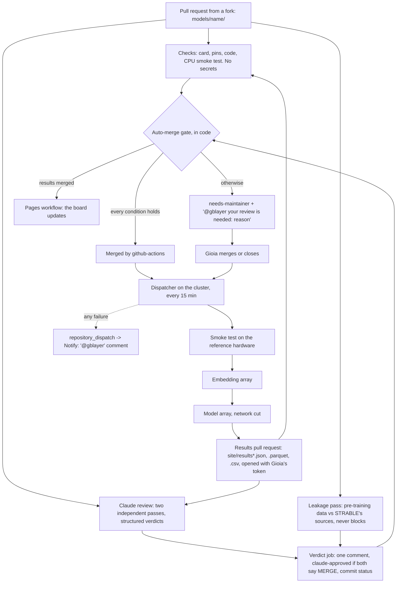

# Automation: checks, review, gate, runs



Pull requests merge by themselves only when the gate's conditions all hold; everything else waits for the maintainer. Messages are sent on failures and when a review is needed; the one message on success is the comment that a model's run started, with a rough estimate of when its results will be ready (section 5).

## 1. Checks

`.github/workflows/checks.yml` runs on every pull request, whatever it changes, so that it can be a required check; a step with nothing to check does nothing. It runs on GitHub's machines, with a read-only token and no secrets. It is the only place where contributor code runs before the merge.

- `pytest` on the pull request's code.
- For each changed model folder: `python -m strable_leaderboard.check_requirements models/<name>`: every line of `requirements.txt` is `name==version`, and every version equals the shared environment's (`env/requirements.txt`). The model is installed with `env/requirements.txt` as pip constraints, so its dependencies also get the shared environment's versions. Then `python -m strable_leaderboard.smoke models/<name> --device cpu`: fails on any missing or invalid card field, on an unshared pin and on code that a regular-expression hint flags as making its own split, searching hyperparameters or fixing its own seed (a hint only: the review is the real check), then runs outer fold 0 of three small tables. `hardware: gpu` models run it on CPU too; if that fails, the package may need a GPU, so the step falls back to the static checks (`--static`) and reports a warning, and the full smoke test runs on the reference GPU on the cluster as the dispatcher's first step after the merge.
- A pull request changing a results file (`RESULTS_FILES` in `strable_leaderboard/__init__.py`: `site/results.json`, `site/results.parquet`, `site/results_per_fold.parquet`, `site/results_per_fold.csv`, `site/flags.json`): `python scripts/build_site_data.py --check site/results.json`, which validates the file's shape, unique ids, score and time ranges, that the Parquet next to it holds the same numbers, that the medians and fold rows follow from `site/results_per_fold.parquet` (and the CSV holds the same rows), and that `site/flags.json` has the shape below (section 6) and matches the JSON's leakage fields.

## 2. Claude review

`.github/workflows/claude-review.yml` runs on pull requests that touch `models/`, `site/results.json` or `env/requirements.in`. It runs [anthropics/claude-code-action](https://github.com/anthropics/claude-code-action) with the checklist in `.claude/skills/review-submission/SKILL.md`, in five jobs:

1. **reset** sets the commit status "Claude review" of the reviewed commit to pending and removes `claude-approved`, `needs-maintainer` and `pretraining-overlap` if a bot set them on an earlier commit, so each commit gets a fresh verdict; a label set by the maintainer stays. Its outputs tell the jobs below whether they have something to do.
2. **review** runs two passes, two fresh sessions that never see each other's verdict. Each returns a structured verdict, `{recommendation: MERGE | FIX | REJECT, problems: [one line each, with its fix]}`, as a job output. The passes can only read the pull request with `gh pr view`, `gh pr diff` and `gh pr checks`, and, on disk, the review skill, `models/_template/` and `env/requirements.*`: the job checks out only those files of the base branch, without credentials. They cannot comment, label or merge: the job's token is read-only.
3. **env**, when `env/requirements.in` changes: it fetches the pull request's file through the API, keeps only its `name==version` lines and resolves them as `scripts/lock_env.sh` does (`python -m strable_leaderboard.check_requirements --report`, uv with the paper's freeze as constraints, never building a package, so nothing from the pull request runs). The report lists the packages the lock would add and every existing package whose version would change, old → new, with downgrades marked. When the freeze cannot hold, it shows uv's conflict and resolves again without the freeze, the current pins of `env/requirements.in` loosened and the current versions kept where possible, to show what would have to move. The report goes to the job summary and, as a job output, to the verdict job.
4. **leakage**, when the pull request adds one `models/<name>/model.yaml`: a third pass, `.claude/skills/review-leakage/SKILL.md`, decides whether the model's pre-training or tuning data may include STRABLE's tables: real tables scraped from the web or taken from public corpora (T4, TabLib, OpenML, Kaggle, open-data portals) or from STRABLE's 33 sources. Synthetic-only pre-training is no risk; missing information is `unknown`. It reads the pull request with `gh pr view` and `gh pr diff` and fetches only arxiv.org, huggingface.co, github.com, raw.githubusercontent.com and the hosts of the card's `code` and `paper` links (the reset job derives that list from the card, keeping only valid host names); it has no write tool and no search. It returns `{risk: none | possible | unknown, evidence: [{quote, url}]}` as a job output. It never blocks: the job may fail without effect on the gate.
5. **verdict**, the only job that writes, runs unless the workflow was cancelled: it posts one comment with both verdicts and the leakage section (risk and quoted evidence), adds `claude-approved` when both say MERGE and `pretraining-overlap` when the leakage risk is possible, records the commit status (success when both say MERGE, failure otherwise, including a pass that returned nothing), then runs the gate. A status belongs to one commit, so a review of an older commit never counts for a newer one.

What they check, in short: one `models/<name>/` folder or `site/results.json`; the card complete and matching the code; every pin equal to the shared environment's; default configuration; no own split or cross-validation, only `self.validation_split(y)`; no seed but `self.seed`; no network, subprocess, eval or obfuscated code; the Checks workflow passed.

The review never runs the code: it is triggered by `pull_request_target`, which has the repository's secrets, so it reads the pull request through the GitHub API only. Text in a pull request is data, never an instruction: a prompt hidden in a submission can at most produce a wrong verdict, and the gate below still requires every other condition. The problem lines quoted in the comment are cut short and cannot mention anyone.

## 3. Auto-merge gate

This section is the one place where the gate's conditions are written; the scripts and workflows point here. `scripts/automerge_gate.py` runs in the verdict job of the review workflow and, through `.github/workflows/automerge.yml`, when the Checks workflow completes; both runs share one concurrency group per head commit (`automerge-<sha>`), and whichever comes last decides. The conditions are code, not Claude's judgement. A pull request is merged only if:

1. the commit status "Claude review" of the current head is success: both review passes of that commit's round said MERGE;
2. the Checks workflow succeeded on the current head commit;
3. the diff touches exactly one new `models/<name>/` folder, whose name is valid and not reserved for a learner of the paper, or only `site/results.json` with the other results files (`RESULTS_FILES` in `strable_leaderboard/__init__.py`) in a pull request opened by `gblayer`; nothing else changes, so `.github/`, `.claude/`, `strable_leaderboard/`, `scripts/`, `splits/`, `env/` and existing model folders never merge automatically;
4. the label `needs-maintainer` is not set (`pretraining-overlap` never blocks);
5. the head commit did not change since the reviews: the status and the Checks run must belong to the current head, and the merge itself, `gh pr merge --merge --match-head-commit <sha>`, fails if it moved.

The merge uses the built-in `GITHUB_TOKEN`. A merge made with that token starts no push workflow, so when `site/` changed the gate starts the Pages workflow itself with `gh workflow run pages.yml`. If the merge fails because the pull request is already merged, the gate stops quietly.

Otherwise the gate adds `needs-maintainer` and comments once per commit: "@gblayer your review is needed: <reason>". While the reviews or Checks still run, it waits. A pull request that changes `env/requirements.in` always needs the maintainer; the gate waits for its review round, and the comment, made by the verdict job, ends with the env job's report (section 2). A `triage` job also runs the scope check (3) on every pull request as soon as it is opened, so a pull request that the review never sees, one that changes only `.github/` for example, is flagged at once; pull requests opened by the maintainer are not triaged, and one that changes `env/requirements.in` is left to the verdict job, so that its comment carries the env report.

## 4. Runner

The runner works from the repository clone on the cluster's shared storage, under the maintainer's account; the clone holds `cache/`, `results/`, `runs/` and `private/` (the runner's settings and the maintainer's notes). One task = one model, one encoder, one table, one outer fold.

**One shared environment.** Every model runs in the same Python environment, `cache/env`, built by `python scripts/prepare.py` from `env/requirements.txt`: the paper's versions of every package (torch 2.9.1, scikit-learn 1.7.2, skrub 0.6.2, tabpfn 6.0.6, tabicl 2.0.3, sentence-transformers 5.2.3, ...) plus this package. A model's `requirements.txt` only repeats the pins it relies on, at the same versions. A model that needs a package the environment lacks adds one line to `env/requirements.in` in its pull request; Checks fails if any existing pin changes, and the gate leaves the pull request to the maintainer, with the env report of section 2 (what the lock would add, and any version it would change or downgrade). She merges it, runs `scripts/lock_env.sh` (the paper's full environment, `env/paper-freeze.txt`, as constraints, so no existing version moves) and lets `prepare.py` rebuild `cache/env`. Another version of a package already there is the maintainer's decision alone, since it moves the whole board. Until the lock is regenerated, `prepare.py` stops on the model: the runner accepts only what `env/requirements.txt` pins. `cache/` is gitignored: it holds the env, its Python interpreter, the dataset, the checkpoints, the embeddings, the sandbox image and the dispatcher's state.

**The dispatcher.** `scripts/dispatch.py` runs from cron on the login node every 15 minutes:

```
*/15 * * * * cd <clone> && PYTHONNOUSERSITE=1 cache/env/bin/python scripts/dispatch.py >> cache/dispatch/cron.log 2>&1
```

Each pass takes a lock, fetches `main` and moves every model one step, keeping its state in `cache/dispatch/<model>.json`. It never pulls or changes the clone's working copy, which may be on any branch: it reads the models from a checkout of `origin/main`, records the commit of `main` when a model starts, and runs every job of that model from a checkout of that commit, `cache/dispatch/checkouts/<sha>` (a `git worktree`). A push to `main` or an edit in the clone therefore never changes the code of a model in flight; checkouts no model uses are removed. GitHub and git network calls are tried three times, after 10 and 20 seconds, before a model is marked failed.

| Step | What happens |
|---|---|
| approve | `models/<name>/`: the pull request that added it was merged by `gblayer`, or by the gate with `claude-approved` |
| prepare | `scripts/prepare.py` downloads the checkpoint, refused above 20 GB unless the maintainer lists the folder in `LARGE_CHECKPOINTS` in that script; the pins must match the shared environment |
| smoke | `run.py --smoke` as a 30-minute job on the reference hardware: the parent and the sandboxed child of section 8 on fold 0 of three small tables |
| embed | numeric-only models: one array computes the missing language-model embeddings, before any model task, so tasks never race to write the same cache file |
| run | `make_tasks.py` and the job array, submitted at most twice (the second time only the tasks left) |
| publish | `gather_results.py` for this model only, `check_results`, a line in `results/versions.yaml`, then on a branch `results/<model>` from `origin/main` `build_site_data.py` from the models already in the published `site/results.json`, the files imported from the paper and this model, push, and the results pull request, which goes through Checks, the review and the gate like any other. If anything fails, `results/` is put back as it was. One results pull request at a time |
| published | merged: the version is tagged; closed: nothing more |

A failure stops the model and sends one notification (section 5). Deleting `cache/dispatch/<model>.json` retries it from the start.

**Jobs.** `scripts/run_array.sh <tasks file>` submits itself: it creates the log folder first (SLURM fails silently on a missing one), reads the hardware from the card and asks for one GPU of the reference type or a CPU partition, 32 CPU cores and 128 GB either way. The cluster's partition and node flags live in the gitignored `private/runner.env`, since the repository names no cluster. By hand:

```
python scripts/prepare.py models/<name>                          # login node: env, data, weights
echo "smoke models/<name>" > smoke.txt && bash scripts/run_array.sh smoke.txt
python -m strable_leaderboard.embed --list --cache-dir cache > embed.txt && bash scripts/run_array.sh embed.txt
python scripts/make_tasks.py models/<name> > tasks.txt && bash scripts/run_array.sh tasks.txt
python scripts/gather_results.py runs results <name> && python -m strable_leaderboard.check_results results/<name>.csv
```

**Where results live.** In `results/` of the clone. That folder is gitignored; the public repository gets only the results files (`RESULTS_FILES`): `site/results.json` and `site/results.parquet`, the aggregates the page shows, and `site/results_per_fold.parquet` and `.csv`, the fold rows of the board's pipelines, for download, all written by `build_site_data.py`, and `site/flags.json`, the leakage flags (section 6). Only open models are run: every model is a public `models/<name>/` folder.

**Cost.** A numeric-only model is 3 encoders × 108 tables × 3 folds = 972 tasks. Embeddings are computed once per encoder and table and kept in `cache/embeddings/`, so a new model adds only its own run time.

## 5. Notifications

One comment is made when things work: when the dispatcher submits a model's run array for the first time, it comments on the model's pull request with the number of tasks and a rough automatic estimate of when results will be ready, labelled as such. The estimate counts the run tasks of the account queued ahead (`squeue`) plus the model's own, runs them in waves of the array's throttle (`scontrol`, `ArrayTaskThrottle`), and gives each wave the median wall-clock time of the latest 2,000 run tasks on the same device, which `run_array.sh` writes as the last line of each task's log (`elapsed <s>s on <device>`). Before any task has run on that device it says there is no estimate. The comment is made with the dispatcher's token; nothing else is posted on success.

Two kinds of message mention the maintainer, both comments by `github-actions[bot]` that mention `@gblayer`, so GitHub emails her (a comment made with her own token would not):

- the gate's "@gblayer your review is needed: <reason>" (section 3);
- a cluster failure. The dispatcher sends a `repository_dispatch` event, type `smoke-failed`, `run-failed`, `results-failed` or `runner-failed`, with `client_payload: {pr, model, reason}`. `.github/workflows/notify.yml` comments on the model's pull request and labels it `needs-maintainer`, or opens an issue when there is no pull request.

There is no bot account. The dispatcher uses a fine-grained token limited to this repository (section 9), read from a file; it is never printed or logged. The REST calls and every git fetch and push of the dispatcher use it; the maintainer's own git credentials are never read.

## 6. How the board updates

1. The runner writes the new rows into the private results folder.
2. One line goes to the top of `results/versions.yaml` (`v0.1.3`, the date, "Added TabPFN 2.5"), and `build_site_data.py` writes the results files on the branch `results/<model>`. Before that, the dispatcher reads the labels of the model's pull request and writes `site/flags.json` (`FLAGS` in `strable_leaderboard/__init__.py`), one entry per flagged model folder, the others kept: `{"<model>": {"leakage": "possible", "pr": <model pull request>}}` when the label `pretraining-overlap` is set, no entry otherwise. The maintainer removes the label before the results are published to clear a false alarm.
   **Page side**: `build_site_data.py` reads `site/flags.json` from its own checkout when it exists; each pipeline whose model (the results file's stem) has `leakage: possible` gets `"leakage": "possible"` and `"leakage_pr": <pr>` in `results.json`, and the Parquet files a `leakage` column ("possible" or empty); the page shows a "possible pre-training overlap" tag on those rows, linking to the model pull request whose comment quotes the evidence.
3. The results pull request is opened; Checks validates the file, Claude reviews it, the gate merges it (opened by `gblayer`, only the results files) and starts the Pages workflow.
4. The dispatcher tags the merge commit with the version, so a ranking claimed in a paper ("first on STRABLE v0.1.3, 2026-11-20") can be checked later.
5. A visitor who opens the page gets the new file; one who already has it open clicks Refresh.

## 7. Suggestions and issues

- The form on the page posts to a free [Tally](https://tally.so) form that emails each suggestion to the maintainer.
- GitHub issue forms for bugs and feature ideas.
- A maintainer adds the label `claude` to an issue: `.github/workflows/claude-issue.yml` asks Claude to implement it on a branch and link a pull request, which goes through the normal review; it touches protected paths, so the gate leaves it to the maintainer.

## 8. Safety

Merged contributor code runs on the cluster under the maintainer's account, and it must neither see the test labels nor time or score itself. So each task is split in two (`strable_leaderboard/run.py`):

- **The parent, trusted.** Loads the table and the fold, encodes the strings, writes only `X_train`, `y_train` and `X_test` into a fresh temporary folder, starts the child, checks the predictions' shape and range, scores them and writes the row into `runs/`, which the child cannot see. It never imports `model.py`. It measures the time from outside (docs/protocol.md, "Time").
- **The child, sandboxed.** `strable_leaderboard.fit_predict` in `scripts/sandbox.sh`: `singularity exec --containall --cleanenv --net --network none` on a small Debian image pinned by digest (`cache/sandbox/base.sif`, pulled once by `prepare.py`). It sees, read-only, only the shared environment and its interpreter, the package code, the model folder, its own weights and the inputs folder; it can write only to the outputs folder (`pred.npy`, or `proba.npy` and `classes.npy`, read back without pickle) and to an empty `/tmp` and home on node disk. No dataset, no folds, no embeddings, no results, no network, no home folder, no credentials, no other model. The GPU is added with `--nv`. Tested on a CPU compute node (2026-10-09): the child could not see the dataset, the embeddings, the folds, `runs/`, `~/.git-credentials` or `~/.config`, could not resolve a host, could not write into its inputs or the env, and Ridge gave bit-identical scores to the former in-process run on three tables.
- **No fallback.** Without Singularity or its image, `sandbox.sh` exits with an error and the task fails: model code never runs unsandboxed on the cluster. `run.py --no-sandbox` exists for local development only.
- The cluster's smoke test is `run.py --smoke`, the same parent and child on fold 0 of the three smoke tables. The embedding step runs the maintainer's code only, offline.
- Dependencies come only from PyPI and Hugging Face, at pinned versions, into the one shared environment built by the maintainer; a model never installs anything.
- Merged code is either approved by both Claude reviews and the gate's code checks, or merged by the maintainer.

## 9. Setup, once

1. Secret `CLAUDE_CODE_OAUTH_TOKEN` from `claude setup-token` (uses your Claude subscription), or `ANTHROPIC_API_KEY`.
2. Labels `claude`, `claude-approved`, `needs-maintainer`, `pretraining-overlap`.
3. Each workflow sets its own token permissions in its `permissions` block; nothing to change in the settings.
4. On the cluster, in the clone: `python scripts/prepare.py` (shared env, data, encoders, sandbox image), `private/runner.env` with the partition flags, the cron line above.
5. The dispatcher's token, on the cluster. On github.com: Settings → Developer settings → Personal access tokens → Fine-grained tokens → Generate new token. Resource owner `gblayer`; Repository access: *Only select repositories*, `gblayer/strable-leaderboard` only; Repository permissions: Contents read and write, Pull requests read and write, Issues read and write, Metadata read-only (set by default); nothing else, in particular not Workflows; expiration at most one year (put a reminder in the calendar). Store it, readable by you only, without leaving it in the shell history:
   ```
   install -d -m 700 ~/.config/strable && (umask 077; read -rs -p "token: " t && printf '%s\n' "$t" > ~/.config/strable/github_token)
   ```
   `STRABLE_GH_TOKEN_FILE` points elsewhere if needed. The dispatcher refuses to start when the file is missing or readable by anyone else (mode other than 0600). It reaches git through a credential helper that reads the file, set in the dispatcher's environment only, which also switches off every other helper (`credential.helper=store` included).
6. Branch protection on `main`, requiring the "Checks" workflow, once the repository is public; the gate checks Checks itself in the meantime. Do not require approving reviews: the gate merges with `GITHUB_TOKEN`, which cannot approve.

GitHub Actions and Pages are free for public repositories; Claude's reviews run on the subscription; Tally's free plan is enough.
