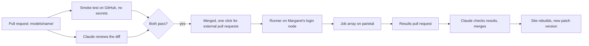

# Automation: review, runs, issues

The goal is a leaderboard that updates itself. Claude reviews and merges submissions, the cluster runs them, and the site rebuilds. The only human steps are optional.

## 1. Smoke test

`.github/workflows/smoke-test.yml` runs on every pull request that touches `models/`. It installs the model's pinned requirements and runs `python -m strable_leaderboard.smoke` on each changed folder, on GitHub's own machines, with no secrets. It is the only place where contributor code runs before merge.

## 2. Claude review and merge

The workflows in `automation/workflows/` use [anthropics/claude-code-action](https://github.com/anthropics/claude-code-action) with the checklist in `.claude/skills/review-submission/SKILL.md`.

- **What Claude checks:**
  - The pull request only adds or edits `models/<name>/`.
  - The contract, pinned versions and a checkpoint hash.
  - Default configuration, and no use of test rows.
  - No network or file access beyond the rules.
  - A filled model card, and nothing obfuscated.
- **Submissions from anyone:** `claude-review-submissions.yml` reviews every pull request and adds the label `claude-approved` when everything passes. A maintainer then merges with one click.
- **Why Claude doesn't merge strangers' pull requests:** the action only runs for people with write access unless told otherwise. Its security guide warns that opening it to everyone is only safe with minimal permissions. With merge rights, a prompt hidden in a pull request could get code merged and run on Margaret. Full auto-merge is a two-line change, described in `automation/README.md`, if you accept that risk.
- **Results and trusted authors:** `claude-review-results.yml` checks results pull requests from the runner account and merges them itself.
- **Why it never runs the code:** the submission review triggers on `pull_request_target`, which has access to secrets. It checks out only the base branch and reads the diff through the GitHub API. The smoke test runs the code, but without secrets.
- **Authentication:** a Claude subscription token from `claude setup-token`, stored as the `CLAUDE_CODE_OAUTH_TOKEN` secret, or an API key as `ANTHROPIC_API_KEY`. Running `/install-github-app` in Claude Code sets this up.
- **Branch protection:** requiring the smoke test before merge is free on public repositories. On a private repository it needs a paid GitHub plan, so turn the automation on when the repository goes public.

## 3. The runner on Margaret

GitHub cannot reach into Inria's network, so something inside Inria must fetch the work. Margaret's login node has internet, and compute nodes appear not to, so the runner splits the work in two:

1. **On the login node:** pull the repository and list pipelines without complete results. Build each model's pinned environment, and download its checkpoint and the encoders' checkpoints into a shared cache.
2. **On compute nodes:** submit a SLURM job array on `parietal`, one task per pipeline, table and outer fold. Each task writes one result row and its log. Preempted or failed tasks are requeued, and finished tasks are skipped on restart.
3. **Back on the login node:** gather the rows, then open a results pull request with scores, times, hardware and logs, using a fine-grained GitHub token that can only open pull requests on this repository.

**Scheduling:** scrontab is disabled on Margaret. The options are a cron job on the login node, if the admins allow it, or one command to run after each merge.

**Encoders:** each table's embeddings are computed once per encoder and fold and cached, so a new numeric-only model only adds its own fit and predict runs.

**Cost of a new numeric-only model:** 5 encoders × 108 tables × 3 folds = 1,620 runs. As a rough estimate, one to three GPU-days, which is a few hours to half a day on the six GPUs of margpu014 to margpu016.

## 4. Results pull request

Claude checks it:
- every table and fold is present;
- scores are within range;
- times are plausible against similar models;
- nothing else changed.

Then it merges. A GitHub Action rebuilds `results.json` and deploys the site to GitHub Pages. The version bumps by one patch, v0.1.3 to v0.1.4, and the version history gets one line. The table, plot and Pareto front are computed in the browser from `results.json`, so they update by themselves.

## 5. Safety

Merged code runs on Inria hardware under the runner's account. Keep the blast radius small:

- A dedicated service account for the runner, if Inria can provide one, instead of your personal account.
- Jobs read the data read-only and write only to their own output folder.
- Compute nodes have no internet, so a model cannot send data out or download code during a run.
- Dependencies come only from PyPI and Hugging Face, at pinned versions.
- If Margaret has Apptainer, run each model inside a container with only its folder mounted.

## 6. Suggestions and issues

- **The form on strable.ai:** a free [Tally](https://tally.so) form. The free plan has unlimited submissions and emails each one to the owner. It needs no account from visitors.
- **GitHub issues:** issue forms for bugs, table problems and feature ideas, for people with a GitHub account.
- **Handing an issue to Claude:** you, or anyone you choose, add the label `claude`. `automation/workflows/claude-issue.yml` then asks Claude to implement it and open a pull request, which goes through normal review.

## 7. Cost

- GitHub Actions is free on public repositories. Private repositories get 2,000 free minutes a month.
- Claude's reviews use your subscription through the token, or API credits through the key.
- Tally's free plan is enough for the suggestion form.
- GitHub Pages is free.
