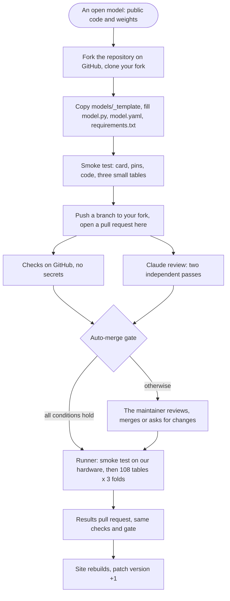

# Submitting a model

You submit code, we run it. One pull request adds one folder, `models/<name>/`:

| File | What it holds |
|---|---|
| `model.py` | `class Model(StrableModel)` with `fit`, `predict` and `predict_proba` |
| `model.yaml` | The model card, below. Every field filled |
| `requirements.txt` | The packages the model imports, at exact versions: `tabpfn==9.0.0` |

No container and no environment of your own: every model runs in **one shared Python environment**, the paper's, pinned in [`env/requirements.txt`](../env/requirements.txt) (torch 2.9.1, scikit-learn 1.7.2, skrub 0.7.0, tabpfn 9.0.0, tabicl 2.0.3, sentence-transformers 5.2.3, xgboost 3.1.1, catboost 1.2.8, ...). Each pin in your `requirements.txt` must equal the shared environment's version. If your model needs a package that is not there, ADD one line `name==version` to [`env/requirements.in`](../env/requirements.in) in the same pull request and say why; edit nothing else in `env/`. Never change an existing pin: Checks fails on it. The pull request then waits for the maintainer: the review workflow reports to her which packages the lock would add and whether any existing version would change, and she relocks the environment with `scripts/lock_env.sh` (the paper's full environment, `env/paper-freeze.txt`, as constraints). A model that needs another version of a package already there cannot come through a pull request: open an issue.

`models/_template/` is the starting point, `models/ridge/` a complete example.

**Folder names.** One folder per model version, named with lowercase letters, digits, dots and hyphens (`kumo-tabular-1.0`); the version itself lives in `model.yaml`. These names are reserved for the learners of the paper, which the maintainer adds: `ridge`, `xgboost`, `extratrees`, `catboost`, `tabpfn-2.5`, `tabicl-v2`, `realmlp`, `tabm`, `mambular`, `contexttab`, `tabstar`, `tarte`. Names starting with `test-` are reserved for the maintainer's test runs.

## How a submission travels



## Step by step

You need a GitHub account. You cannot push to this repository, so you work on your own copy of it:

1. **Fork.** On https://github.com/gblayer/strable-leaderboard, click *Fork*. GitHub makes a copy of the repository under your account, `github.com/<you>/strable-leaderboard`, which you can push to.
2. **Clone your fork** to your machine: `git clone https://github.com/<you>/strable-leaderboard && cd strable-leaderboard`, then `git checkout -b add-<name>`.
3. **Add the folder.** `cp -r models/_template models/<name>` and fill the three files: one folder per model version, not a reserved name (above). Or tell your coding agent *"Add my model to the STRABLE leaderboard, test it, and open a pull request."*: it follows [`.claude/skills/add-model/SKILL.md`](../.claude/skills/add-model/SKILL.md), fills every card field from the model's package, documentation and paper, and runs the smoke test.
4. **Test** in the shared environment's versions:
   ```
   pip install -c env/requirements.txt -e ".[smoke]" -r models/<name>/requirements.txt
   python -m strable_leaderboard.smoke models/<name>
   ```
   It fails on any missing or invalid card field, on a pin that differs from the shared environment, on wrong prediction shapes, and on code that a regular-expression hint flags as making its own folds or fixing its own seed (a hint only: the Claude review is the real check). Fix every FAIL line. A GPU model runs on CPU too if its package allows it (`--device cpu`, which Checks also tries); if not, run `--static` and say so in the pull request: we run its smoke test on our GPU.
   Python 3.12 or later.
5. **Push and open the pull request.** `git push -u origin add-<name>`, then on GitHub open a pull request from your fork's branch to `gblayer/strable-leaderboard`, `main`, titled `Add <Name> <version>`, with the template filled and the smoke test output pasted. Only `models/<name>/` may change, plus added lines in `env/requirements.in`.

What happens next is automatic. GitHub runs the Checks; Claude reviews the pull request twice, and a third pass reads the model's paper, Hugging Face card and README to see whether its pre-training data may include STRABLE's tables (real tables from the web, Kaggle, OpenML, open-data portals or STRABLE's sources; synthetic pre-training is no risk). That pass never blocks the merge: when the overlap is possible, the pull request gets the label `pretraining-overlap` with the quoted evidence, and the board tags the model's rows. If both reviews say MERGE, the Checks pass and the diff is exactly your new folder, the pull request merges by itself; otherwise, for example when it adds a package, the maintainer is asked to look. After the merge our runner smoke-tests the model on the reference hardware and starts the 108 tables; it then comments on your pull request with the number of tasks and a rough automatic estimate of when results will be ready. It opens the results pull request when they are, and the board updates. If anything fails, the maintainer is told on your pull request. See [automation.md](automation.md).

## The model contract

The contract is the interface every model implements, so that the runner can train, time and score all models the same way. It is the class `StrableModel` in `strable_leaderboard/model.py`:

- `handles_strings = True`: `fit` and `predict` receive the raw table, and the row is tagged **end-to-end**. `False`: they receive a numeric table from one of the four string encoders (Tf-Idf, Qwen-3-8B first-30, LLaMA-3.1-8B first-30, MiniLM-L6-v2 PCA-30, as in the paper), and the runner pairs the model with all four.
- `fit(X, y)` trains on the outer training rows of the paper's folds, which the runner reads from `splits/`. Classification targets are integers 0..K-1; the model sets `self.classes_`.
- `predict(X)` returns values or labels. `predict_proba(X)` returns one column per class, in the order of `self.classes_`.
- **No folds of your own.** Never split, cross-validate or search hyperparameters: no `train_test_split`, `KFold`, `GridSearchCV` or internal validation split of your own. Early stopping may only use `fit_idx, val_idx = self.validation_split(y)`, the paper's first inner fold (inner 8-fold, seed 1234). Turn off a package's own validation split (for example `early_stopping=False`, or pass the protocol's split as its validation set).
- **No seed of your own.** Pass `self.seed` (1234) wherever a seed goes; never a number.
- `self.device` and `self.n_jobs` are given, and the runner already caps BLAS, OpenMP and torch threads to `self.n_jobs`. Pass `self.n_jobs` to the package, unless the package misreads it (tabicl 2.0.3 uses max(all cores, `n_jobs`) threads): then leave its default. Weights load from `self.weights_dir`: there is no network during a run.
- Default configuration. Never read the tables, the split files or the test rows yourself.

## The model card

Every field is required unless marked optional, and the smoke test (`strable_leaderboard/card.py`) fails on a missing field, an unknown field, a value outside the allowed ones, a checkpoint revision that is not a full 40-character commit hash, a table name that is not a STRABLE table, or a value left from the template.

```yaml
name: TabPFN
version: "2.5"
handles_strings: false          # false: four encoder rows. true: end-to-end
tasks: [regression, binary, multiclass]
variant: default                # the only value accepted for now
hardware: gpu                   # gpu | cpu

package: tabpfn==9.0.0          # the code, same pin as requirements.txt
checkpoint:                     # the weights, or null
  repo: Prior-Labs/TabPFN-2.5
  revision: <40-character commit hash>
  files: ["*.ckpt"]             # optional: only the files the model loads
licence: Prior Labs licence
trained_on_strable: []          # STRABLE tables seen in pre-training or tuning

code: https://github.com/PriorLabs/TabPFN      # optional
paper: https://arxiv.org/abs/<id>              # optional
```

What the board derives from it:

| Field | On the board |
|---|---|
| `handles_strings` | The end-to-end tag, or one row per encoder |
| `hardware` | Whether the row used the GPU, shown when hovering the row |
| `variant` | Nothing yet: only `default` is accepted |
| `trained_on_strable` | A contamination note on the row. The leakage pass also reads your paper and card for pre-training data from STRABLE's sources: link them in `paper` and `code` |

**Variants.** Only `variant: default`, the package's default configuration, is accepted for now. Tuned and tuned-plus-ensembled variants will come later with a fixed protocol (search space, budget, ensembling) that every model follows; each will then be a separate folder. Do not submit them yet.

**Open models only.** The code is on PyPI and the weights are on a public Hugging Face repository, so anyone can rerun the pipeline from the folder and the public folds. Closed models (private code or weights) and anonymous submissions are not accepted, and neither are models reachable only through a vendor's API: they would run on the vendor's servers, so neither the time nor the hardware would be comparable.

Why a commit hash in `checkpoint.revision`: a Hugging Face repository is a git repository, and vendors update weights in place. The hash pins the exact weights that were benchmarked, so the row can be reproduced later; a branch name like `main` would silently point to newer weights.

There is no family field. Whether a model is a tree ensemble or a foundation model changes nothing in how it runs or ranks, and its own page says so.

## Package, weights, checkpoint

- The **package** is the code, pinned in `requirements.txt` and in the card's `package` field, at the shared environment's version.
- The **weights** are what the model learned in pre-training. A **checkpoint** is the file holding them, on Hugging Face. For the leaderboard the two words mean the same file, pinned by its repository and commit hash in `model.yaml`.
- The repository stores neither: only the pins. The runner downloads the checkpoint into a cache before the job starts, and jobs run in a sandbox without network. `self.weights_dir` is the Hugging Face repository at the pinned revision: its file `<file>` is at `self.weights_dir / "<file>"`. If a package downloads its weights on first use, give it that path or point its cache setting at `self.weights_dir`.
- The smoke test downloads the checkpoint the same way, into `cache/weights/<name>/` of your clone (gitignored; `$STRABLE_CACHE` moves `cache/`, `--weights-dir` gives another folder), so it runs the code path of the runner.
- A repository that holds several checkpoints: list the files the model loads in `checkpoint.files` (names or patterns such as `*.ckpt`), and only those are downloaded. A checkpoint above 20 GB needs the maintainer's approval.

## Versions

Each model version is its own folder and its own row, forever: `models/tabpfn-3/` and `models/tabpfn-3.5/`, each with its `version` in `model.yaml`. Each pins its own checkpoint hash, so a new release never changes an older row. If a new checkpoint loads with the same package, the new folder can copy `model.py` and change only `model.yaml`. The runner computes only what is missing. A change to a folder that is already on `main` is never merged automatically.

A version whose package is incompatible with the shared environment (one that needs another version of a package the environment already pins) cannot enter through a normal pull request: it needs an environment change, which the maintainer decides.

## Examples

**Open, numeric-only: Kumo Tabular.** NVIDIA's in-context model takes numerical and categorical columns; text needs preprocessing, so on STRABLE it is paired with the four encoders, like TabPFN and TabICL.
1. `cp -r models/_template models/kumo-tabular-1.0`
2. `model.py`: `handles_strings = False`; `fit` builds `sdm.models.KumoTabular` on `self.device` and stores the context; `predict_proba` returns the class probabilities in the order of `self.classes_`.
3. `model.yaml`: `hardware: gpu`, `package: structured-data-models==<version>`, `checkpoint: {repo: nvidia/Kumo-Tabular, revision: <commit hash>}`, `licence: OpenMDW-1.1 weights, Apache-2.0 code`.
4. `structured-data-models` is not in the shared environment: the pull request also adds the line `structured-data-models==<version>` to `env/requirements.in`, and the maintainer relocks.
5. Smoke test on a GPU machine, then the pull request `Add Kumo Tabular 1.0`.

**Open, end-to-end: a model that reads strings itself.** Same steps with `handles_strings = True`; `fit` receives the raw DataFrame with its string, numeric and datetime columns. The board shows one row with an end-to-end tag.
