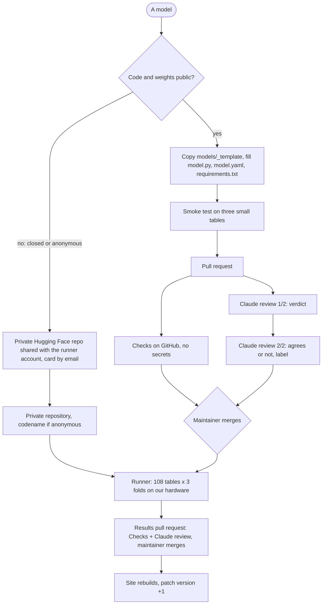

# Submitting a model

You submit code, we run it. One pull request adds one folder, `models/<name>/`:

| File | What it holds |
|---|---|
| `model.py` | `class Model(StrableModel)` with `fit`, `predict` and `predict_proba` |
| `model.yaml` | The model card, below |
| `requirements.txt` | Exact versions: `tabpfn==6.0.6` |

`models/_template/` is the starting point, `models/ridge/` a complete example.

## How a submission travels



## Three steps

1. `cp -r models/_template models/<name>` and fill the three files. The folder name carries the version: `tabpfn-2.5`.
2. Test: `pip install -e ".[dev]" -r models/<name>/requirements.txt && python -m strable_leaderboard.smoke models/<name>`
3. Push a branch `add-<name>` and open the pull request, title `Add <Name> <version>`.

A pull request always comes from a branch, never from `main`. Contributors without write access first **fork** the repository (a copy under their own GitHub account, made with the Fork button), push the branch there and open the pull request from it; GitHub shows that pull request here, with its diff and checks, while the branch itself stays in the fork. Cloning is different: a clone is a copy on your own machine, and you can only push it to repositories you may write to. This is the standard GitHub flow, used by TabArena as well.

Or clone the repository and tell your coding agent: *"Add my model to the STRABLE leaderboard, test it, and open a pull request."* It follows `.claude/skills/add-model/SKILL.md`.

After that: Claude reviews the pull request and posts a verdict, a maintainer merges, the runner computes all 108 tables, and the board updates. See [automation.md](automation.md).

## The model contract

The contract is the interface every model implements, so that the runner can train, time and score all models the same way. It is the class `StrableModel` in `strable_leaderboard/model.py`:

- `handles_strings = True`: `fit` and `predict` receive the raw table, and the row is tagged **end-to-end**. `False`: they receive a numeric table from one of the three string encoders, and the runner pairs the model with all three.
- `fit(X, y)` trains on the outer training rows. Classification targets are integers 0..K-1; the model sets `self.classes_`.
- `predict(X)` returns values or labels. `predict_proba(X)` returns one column per class, in the order of `self.classes_`.
- `self.seed`, `self.device`, `self.n_jobs` are given. Weights load from `self.weights_dir`: there is no network during a run.
- Default configuration. Early stopping may use `self.validation_split(y)`, the protocol's first inner fold.
- Never read the tables, the split files or the test rows yourself.

## The model card

```yaml
name: TabPFN
version: "2.5"
handles_strings: false          # false: three encoder rows. true: end-to-end
tasks: [regression, binary, multiclass]
variant: default                # default now; tuned and tuned-ensembled later
access: open                    # open | closed
hardware: gpu                   # gpu | cpu
gpu_memory_gb: 24               # optional

package: tabpfn==6.0.6          # the code, same pin as requirements.txt
checkpoint:                     # the weights, or null
  repo: Prior-Labs/TabPFN-2.5
  revision: 0123456789abcdef    # commit hash
licence: Prior Labs licence
trained_on_strable: []          # STRABLE tables seen in pre-training or tuning

code: https://github.com/PriorLabs/TabPFN      # optional
paper: https://arxiv.org/abs/0000.00000        # optional
```

What the board derives from it:

| Field | On the board |
|---|---|
| `handles_strings` | The end-to-end tag, or one row per encoder |
| `access` | `closed`: a closed tag |
| `hardware` | Whether the row used the GPU, shown when hovering the row |
| `variant` | Nothing yet: only `default` is accepted. Tuned and tuned-ensembled rows come later, each from its own folder |
| `trained_on_strable` | A contamination note on the row |

Why `access` matters: *open* means anyone can rerun the pipeline, since the code, the weights, the folder and the folds are public; *closed* means we ran it on our hardware with weights shared privately, so the numbers are comparable but only we could produce them. The Pareto front is computed from the results, so a closed model is on it only if nothing beats it.

Models reachable only through a vendor's API are not on the board: they would run on the vendor's servers, so neither the time nor the hardware would be comparable. A vendor who wants a row shares the weights privately and the model runs as closed.

Why a commit hash in `checkpoint.revision`: a Hugging Face repository is a git repository, and vendors update weights in place. The hash pins the exact weights that were benchmarked, so the row can be reproduced later; a branch name like `main` would silently point to newer weights.

There is no family field. Whether a model is a tree ensemble or a foundation model changes nothing in how it runs or ranks, and its own page says so.

## Package, weights, checkpoint

- The **package** is the code, installed with pip and pinned in `requirements.txt`.
- The **weights** are what the model learned in pre-training. A **checkpoint** is the file holding them, on Hugging Face. For the leaderboard the two words mean the same file, pinned by its repository and commit hash in `model.yaml`.
- The repository stores neither: only the pins. The runner downloads the checkpoint into a cache before the job starts, and jobs run offline. If a package downloads its weights on first use, point its cache setting at `self.weights_dir`.

## Versions

Each version is its own folder and its own row, forever: `models/tabpfn-2.5/`, `models/tabpfn-3/`, `models/tabpfn-3.5/`. Each pins its own package version and checkpoint hash, so a new release never changes an older row. If a new checkpoint loads with the same package, the new folder can copy `model.py` and change only `model.yaml`. The runner computes only what is missing.

## Open, closed, anonymous

| | Code and weights | Runs on | Eligible for the front | How to submit |
|---|---|---|---|---|
| Open | Public | Our hardware | Yes | Public pull request |
| Closed | Private, shared with us | Our hardware | Yes, with a *closed* tag | Private channel |
| Anonymous | Private, shared with us | Our hardware | Yes, under a codename with an *anonymous* tag | Private channel |

Closed and anonymous are the same case; anonymous also hides the name. Neither fits a public pull request. Instead:

1. The submitter creates a repository on huggingface.co, sets it to private (Settings → *Make private*: only the owner and the people listed under Settings → *Collaborators* can see or download it), uploads the package and the weights, and adds our runner account as a read collaborator. Our runner account is a Hugging Face user that exists only to download submissions.
2. The submitter emails the model card and `model.py` to the maintainer.
3. The maintainer puts the folder into the private GitHub repository `strable-leaderboard-private`, same layout as `models/`. Anonymous entries get a codename from `strable_leaderboard.codenames` and `anonymous: true` in the card; the codename-to-model mapping never leaves that repository.
4. The runner, a script on the cluster login node using the runner account's token, downloads the private repository, runs the model like any other, and the results are published here under the name or the codename. The weights never become public.

## Examples

**Open, numeric-only: Kumo Tabular.** NVIDIA's in-context model takes numerical and categorical columns; text needs preprocessing, so on STRABLE it is paired with the three encoders, like TabPFN and TabICL.
1. `cp -r models/_template models/kumo-tabular-1.0`
2. `model.py`: `handles_strings = False`; `fit` builds `sdm.models.KumoTabular` on `self.device` and stores the context; `predict_proba` returns the class probabilities in the order of `self.classes_`.
3. `model.yaml`: `access: open`, `hardware: gpu`, `package: structured-data-models==<version>`, `checkpoint: {repo: nvidia/Kumo-Tabular, revision: <commit hash>}`, `licence: OpenMDW-1.1 weights, Apache-2.0 code`.
4. Smoke test on a GPU machine, then the pull request `Add Kumo Tabular 1.0`.

**Open, end-to-end: a model that reads strings itself.** Same steps with `handles_strings = True`; `fit` receives the raw DataFrame with its string, numeric and datetime columns. The board shows one row with an end-to-end tag.

**Closed or anonymous.** The private channel above. On the board the row looks like any other, plus its tag.
